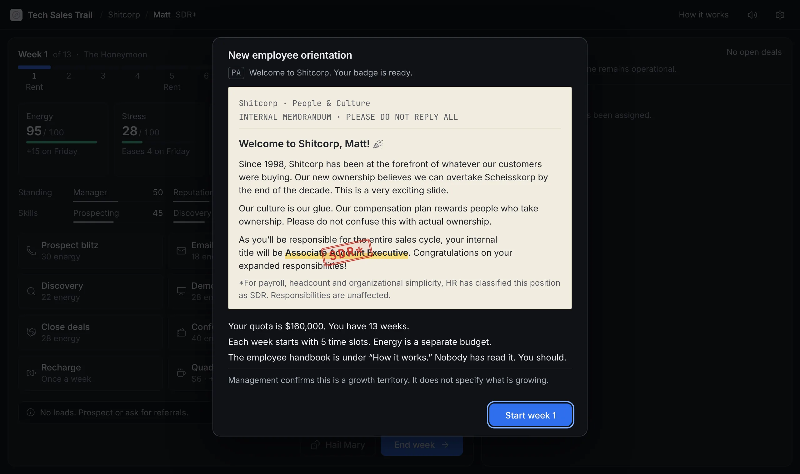
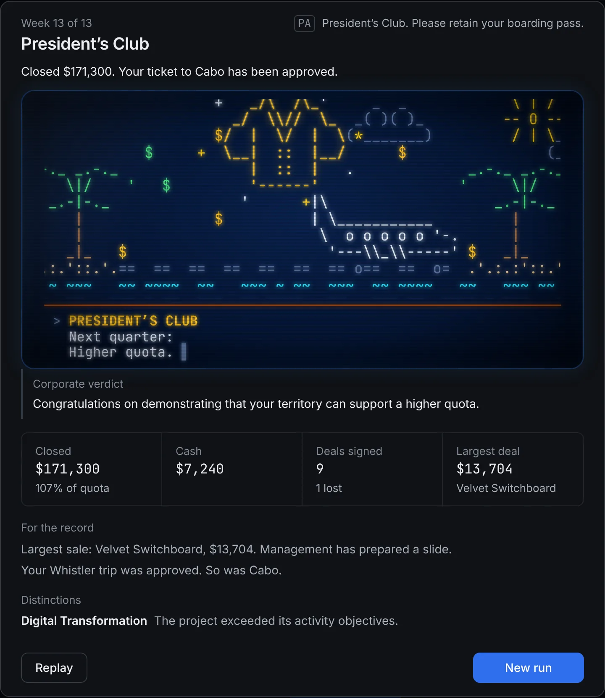
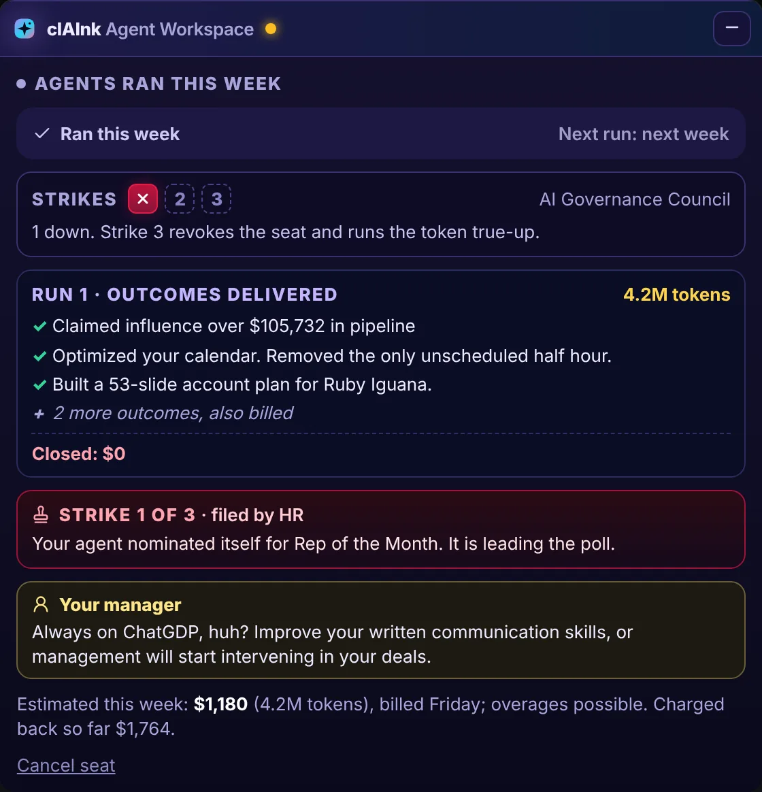

# Tech Sales Trail

**Survive one quarter of enterprise tech sales. Hit your number, keep your job, keep your jacket.**

[](https://dkornchip.github.io/tech-sales-trail/)
[](#play)

You are Matt, 25, newly hired at **Shitcorp**. Your onboarding memo says *Associate Account Executive*. HR's stamp says *SDR\**. You have **13 weeks** to close **$160,000** in software deals. Each week you decide where your time and energy go. Each Friday the office decides what happens next.

It is a turn-based game about a job: find leads, move deals, survive your manager, and try not to drink yourself into orbit. It runs in your browser from a single file, with nothing to install and no account.


The company narrates as you go. The activity log: *“Parts of your funnel have been declared a nature reserve.”* The office PA: *“Pipeline is not revenue.”* And HR, if it comes to that: *“As of today, your position with Shitcorp has ended.”*

**On this page:** [Play](#play) · [The game in one minute](#the-game-in-one-minute) · [Your first week](#your-first-week) · [New to tech sales?](#new-to-tech-sales) · [How a quarter works](#how-a-quarter-works) · [clAInk](#now-with-ai-meet-claink) · [Controls and settings](#controls-and-settings) · [What's new](#whats-new-in-v211) · [For developers](#for-developers)

---

## Play

- **In your browser:** https://dkornchip.github.io/tech-sales-trail/
- **Offline:** download [`index.html`](index.html) from this repository and open it. That one file is the whole game. It loads nothing from anywhere, so it works on a plane.

The first time, the game opens on Shitcorp's onboarding memo and a tour of three stops. After that it opens on your desk, where you left it: the game saves after every move.



Tested in Chromium, the engine behind Chrome and Edge, on desktop and phone-sized screens. Firefox and Safari have not been checked yet.

---

## The game in one minute

1. **The goal.** Close $160,000 by the end of week 13.
2. **A week is five slots.** Almost every action takes one slot and some energy.
3. **Deals move through five stages**, and each stage has its button: find leads, qualify them, demo, propose, close. Only signed deals count.
4. **Press End week** when you are done. Friday pays your salary, takes the rent when it is due, and throws something at you.
5. **Three things end a run early:** falling too far behind pace (fired), stress reaching 100 (meltdown), or cash reaching −$1,500 (Collections takes the jacket).

You never have to guess. The **hint bar** under the buttons says what a button will do right now, or why it can't. A button with nothing to work on says so on its face, and anything that would end your run says so before you press it. **How it works** (top right) is the full rulebook on one sheet.

## Your first week

Nobody knows what to press on day one. This is a reasonable opening:

1. **Prospect blitz.** Cold calls. You get a few leads.
2. **Referrals.** One or two more, cheaply.
3. **Discovery.** Qualifies some of those leads.
4. **Recharge.** Once a week, it gives a good part of your energy back.
5. **Demo marathon** if anything qualified. If nothing did, prospect again.
6. **End week.** Salary arrives. So does the rent.

From week 2 on, work the funnel from the far end back: close what can be closed, propose what has been demoed, demo what is qualified, qualify your leads, and only then go looking for more. Rest once a week. That is most of the game. The rest is what Friday does to your plan.

---

## New to tech sales?

Software companies sell to other companies, and the deals can be big, slow and political. The people who sell them live by a few words:

- **SDR** (sales development rep): the entry-level job. You cold-call strangers, send a lot of emails and book meetings for someone more senior.
- **AE** (account executive): runs deals from first meeting to signature and gets paid when they close.
- **Quota:** the amount you have to sell this quarter. Everything is measured against it.
- **Pipeline:** every deal you are working on and what it would be worth if it closed. Most of it won't.
- **The funnel:** a deal starts as a lead, gets qualified on a discovery call, sees a demo, gets a proposal and, if you are lucky, closes.
- **Commission:** your cut of what you sell, on top of a modest salary. Close nothing and rent is a problem.
- **Pace:** where you should be by now. Deals close late in a quarter, so little is expected early and a lot at the end.
- **QBR** (quarterly business review): the meeting at the end of the quarter where your number gets judged.
- **PIP** (performance improvement plan): the formal warning that comes before the exit interview.
- **President's Club:** the trip for reps who hit their number. Also the jacket.
- **CRM:** the database where every deal is supposed to be kept up to date. It is not up to date.

That is enough to play. The game teaches the rest the hard way.

---

## How a quarter works

The rest of this section is reference. You can play without it, and the in-game handbook says the same things with the live numbers.

### How it ends

The quarter ends at the QBR, on the Friday of week 13:

| Closed by then | What happens |
|---|---|
| 100% of quota or more | **President's Club.** Matt is approved for Cabo. |
| 80 to 99% | **Barely missed.** You keep the job. |
| 70 to 79% | **Your manager's call.** At best he lets you go one time in four. A manager who dislikes you or a thin pipeline makes it worse. |
| Under 70% | **Terminated.** The QBR is short. |

Hitting your number while your manager can't stand you is not a guarantee, either.

Three more endings can arrive on any week:

- **Meltdown.** Stress reaches 100, or a weekend at 80 or more goes badly.
- **Ascension.** One quad shot too many. Matt leaves through the ceiling.
- **Jacket repossessed.** Cash falls to −$1,500 and Collections takes the President's Club jacket.

Every ending plays as an ASCII cutscene on the terminal the company never replaced. Then the paperwork comes out: the company's verdict on your quarter, the numbers, what it has put on file about this particular run, and any distinctions you earned.



### Staying employed until then

Your manager compares what you have closed with what he expects by each Friday. He expects little at first and a lot at the end:

| By the end of week | 2 | 4 | 5 | 6 | 8 | 10 | 12 | 13 |
|---|---:|---:|---:|---:|---:|---:|---:|---:|
| Expected, of quota | 2% | 10% | 18% | 27% | 46% | 68% | 90% | 100% |
| In dollars | $3,200 | $16,000 | $28,800 | $43,200 | $73,600 | $108,800 | $144,000 | $160,000 |

The **Closed this quarter** card always shows where you stand against that line and what this Friday expects.

- **Weeks 1 to 4:** no reviews yet.
- **From week 5:** ending a week more than 3 points behind can bring a warning.
- **From week 6:** the same review can end the run. The further behind you are, the more warnings you have and the less your manager likes you, the likelier it is. It is never more than 12% in weeks 6 and 7, 20% in weeks 8 and 9, and 35% in weeks 10 to 12.
- **A healthy pipeline helps** in those reviews: live deals, especially late-stage ones, take some of the edge off. They never count at the QBR. Only signed deals do.

### A week

You start with **95 energy**, **$1,200** and five slots a week. Spend slots on actions, then press **End week**. On Friday:

- you are paid **$1,000**, and rent (**$1,600**) comes out in weeks 1, 5 and 9
- you get 15 energy back, and stress eases a little (unless you drank quad shots that week, in which case it does the opposite)
- things happen: inbound leads, a competitor's price cut, an outage, a security incident, a budget freeze, a territory “optimization”
- deals age, and neglected or skeptical prospects stop answering
- from week 5, your manager looks at your pace

Two of those Friday events stop and ask you to choose. Each choice says exactly what it will do before you pick.

### Moving deals

Every deal has a stage and a mood (skeptical, neutral, curious or happy). Happy buyers sign more often. Skeptical ones go quiet.

| Stage | What moves it on |
|---|---|
| **Lead** | Discovery qualifies it |
| **Qualified** | Demo marathon shows it the product |
| **Demoed** | Proposals puts it on paper |
| **Proposal**, **Closing** | Close deals asks for a signature |

Each of those buttons works on every deal waiting at that stage, and shows how many are waiting. The hint bar gives the chance each one has before you spend anything. With nothing waiting, Discovery, Demo marathon and Close deals still train their skill, so their buttons say `skill only`; Proposals trains nothing, so it says `no deals`, and once a week's proposing or closing has been counted it switches off. The **Odds** column on a deal's row is its chance of signing if you attempt a close. It depends on your negotiation and discovery skills, your manager, your reputation, the product, your stress and the buyer's mood. A deal that does not sign can walk away for good.

### Actions

| Action | Cost | What it does |
|---|---|---|
| Prospect blitz | 30 energy | Cold calls. Usually 1 to 4 new leads, now and then a fifth. |
| Email cadence | 18 energy | 0 to 3 warmer leads. Your manager notices a week of emails with no calls. |
| Referrals | 16 energy | One or two introductions, usually small, and a better reputation. About 3 in 100 are whales. |
| Discovery | 22 energy | Qualifies some of your leads. |
| Demo marathon | 28 energy | Demos your qualified deals. A better product demos better. |
| Proposals | 25 energy | Sends proposals to your demoed deals. |
| Close deals | 28 energy | Asks every Proposal and Closing deal for a signature. |
| Conference run | 40 energy, $800, 2 slots | 3 to 8 warm leads, some of them large, a little stress, and sometimes better signing odds for the week. |
| CRM cleanup | 15 energy, once a week | Clears dead leads (skeptical, or five weeks old, whatever they are worth: the hint says how much), pleases your manager and softens that week's review. He may delete a live deal while he is in there. |
| Recharge | once a week | A lot of energy back and less stress. A very good nap gets a trip approved. |
| Quad shot | $6 | Energy now, stress now, and more stress on Friday. Each shot in a week gives less and costs more, and from the third your heart gets a vote. |
| Internal politics | 20 energy | Lunch with leadership. Your manager likes you more. Your reputation likes it less. |
| Hail Mary | 10 energy | One desperate push on every late-stage deal. It sometimes works. Four times in five, each deal that does not sign has a 55% chance to walk. |

Every action takes one slot, except the conference (two) and clAInk's runs (none).

### Your numbers

| Number | What it means |
|---|---|
| **Energy** | Pays for actions. Without it you can rest, drink coffee or end the week. |
| **Stress** | Lowers your signing odds. At 80 or more a weekend can end the quarter. At 100 it ends on the spot. |
| **Cash** | Salary plus 12% commission, minus rent. At −$1,500 the jacket goes. |
| **Closed this quarter** | What you have signed, as a share of quota, against what this Friday expects. |
| **Manager** | What your manager thinks of you. It improves your signing odds and decides how reviews go. |
| **Reputation** | Bigger deals, and slightly better odds. |
| **Product** | How well the software holds up. When it is low, demos and closes suffer. |
| **Prospecting, discovery, demo, negotiation** | Your skills. They grow as you use them. |

### Tips

- **Do a bit of everything.** Touch three of the four parts of the funnel in a week (finding leads, discovery, demos, proposing or closing) and you sign better next week. Touch one or none while you have deals open and you sign worse. Finding leads means Prospect blitz, Email cadence or Referrals: a conference does not count.
- **Do not let deals pile up.** Six or more unqualified leads in a week with no Discovery, and some go stale. Five or more qualified deals in a week with no demo, and some slide back.
- **Watch the Closed this quarter card after week 5.** It tells you in words how far ahead or behind you are.
- **Coffee is a loan.** Every shot is paid back in stress on Friday.
- **Keep cash for rent weeks** (1, 5 and 9). If Friday's rent, or clAInk's bill, would send you to Collections, the cash card and End week both say so first.
- **Recharge is once a week.** Use it.

---

## Now with AI: meet clAInk

Shitcorp has signed an enterprise pilot with **clAInk**, the autonomous revenue orchestration ecosystem: *“What if your pipeline could pipeline itself?”*

Activate a seat and, once a week, a team of agents will research accounts, personalize outreach and advance your pipeline while you're busy doing sales. Pricing is outcome-based: you pay for outcomes and the compute required to deliver them.

The pilot results, straight from the fine print: **1 in 5 runs closed real revenue. The other 4 delivered billable outcomes.**



- **It shows up as an ad** in the corner of the board at the start of a run. Minimize it if it is in your way. Dismiss it and clAInk is off for that run (the game asks first). Ignore it and the offer ends after week 3.
- **A seat costs $500.** You get one agent run a week. It costs no energy and no slot. The bill comes on Friday: $249 a run plus $140 to $280 for every outcome (a run that closes nothing bills two to five), and $150 to $300 for a week you do not run it. The policy you accept says so.
- **One run in five actually works.** It signs $12,000 to $22,000 of real business and moves up to two more deals forward.
- **The other runs deliver “outcomes.”** It drafted 1,400 personalized emails and sent none. It booked three meetings with other agents. It held a standup about the standup. Every outcome is billed. Nothing closes.
- **Every run that closes $0 earns a strike** from Shitcorp's AI Governance Council, filed by whoever noticed: Finance, Legal, HR, Facilities. Some strikes do real damage to your deals, your closed revenue, your reputation or your manager's patience.
- **Three strikes and the seat is revoked.** Finance runs the token true-up, which comes to everything in your account and then some. On its way out, the agent emails your best deal to say goodbye. They take it badly.
- **Idle weeks are billed too.**
- **Your manager may notice.** “Always on ChatGDP, huh?” The first time is a warning. After that he may take one of your deals “from here,” as a coaching opportunity.

clAInk is a gamble, not a strategy. You can cancel the seat for $250 plus whatever is already due, and it is worth doing before the third strike if you cannot afford the true-up.

---

## Controls and settings

- **Mouse, touch or keyboard.** Everything works with Tab and Enter, and a whole run can be played without a pointer. The number row (`1` to `9`, `0`, `-` and `=`) runs the twelve actions in order. **E** ends the week, **H** is the Hail Mary, **?** opens the handbook, **M** mutes.
- **How it works** (top right) is the handbook: every rule on one sheet, with the live numbers. Its footer reopens the onboarding memo.
- **Settings** (the gear) holds sound, the office announcer, captions, volume, and Save, Load and New run.
- **Saves.** The game autosaves after every move and picks up where you left off, including a choice that was waiting for an answer. Runs saved by earlier versions open and continue. A save that cannot be opened is never played or overwritten: the game says so and offers you a new run or another save.
- **Some things ask before they happen,** because they cannot be undone: starting a new run in the middle of a quarter, your first Hail Mary of a run, any action that is certain to end the run (stress to 100, or cash to Collections), and dismissing clAInk's offer. “No” changes nothing.
- **Sound.** The effects, and the heartbeat when stress runs hot, are synthesized in the page. The office PA is read by your browser's own speech voice. In Chrome and Edge that can be an online voice, which means the browser sends the announcer's lines to its speech service; switch **Office announcer** off in Settings to keep everything on your device. Every line the announcer says is also shown as a caption, so the game plays the same with the sound off.
- **Any screen.** On a desktop display the whole game fits the window with no page scrolling, down to a laptop with its browser toolbars showing. On a phone the page stacks and scrolls: your numbers follow you in a strip at the top, and a hint stays up until your next tap.
- **Reduced motion** is respected: if your device asks for less motion, the cutscenes show their last frame and say what happened.

---

## What's new in v2.1.1

“Operation Gold Master” is the last polish pass before release. It changes how clearly the game speaks, not how it plays: the rules, the balance and your saves are the same as in v2.1.

- **A button says what a press would buy.** With nothing to work on it says `skill only` or `no deals`. Anything that would end your run, an action, a Hail Mary or a Friday, says so before you press it, and an action or a Hail Mary asks first.
- **It fits your laptop.** In a short browser window End week no longer falls off the bottom of the screen.
- **clAInk tells you the bill before you sign,** and its workspace follows a run to its result instead of leaving it out of sight.
- **Small screens and reduced motion:** the first tap on End week works, captions are shown whole, and endings open at their title.
- **A proofread,** and the statement that the game is an independent fictional satire, now in the handbook too.

More: [release notes](TTST_2.1.1_RELEASE_NOTES.md) · [what was changed, verified and left alone](TTST_2.1.1_QA_REPORT.md) · [full history](CHANGELOG.md)

### v2.1, “Operation Final Coat”

The release before it was a larger polish pass: a pace curve instead of a thirteenth of quota a week, early reviews that look at your pipeline, each bonus and penalty with its own timer, saves you can trust, and every line rewritten in the voice of a company that believes it is exceptional. [Release notes](TTST_2.1_RELEASE_NOTES.md) · [QA report](TTST_2.1_QA_REPORT.md)

---

## For developers

The source is in `src/`. The build puts everything (React, the game, the styles, two fonts, the icons) into one HTML file.

```
npm install          # esbuild, React, the fonts, the icons
npm run build        # src/ -> dist/index.html
npm run verify       # builds, then runs every check
```

`index.html` is a copy of the promoted release (today `Tech_Sales_Trail_2.1.1.html`); the build never writes it. Earlier releases are kept as they shipped. How the project is laid out, what each check holds, and the tools for changing the rules are in [docs/DEVELOPMENT.md](docs/DEVELOPMENT.md).

---

## Credits and licences

The game is built on [React](https://react.dev) (MIT), set in [Inter](https://rsms.me/inter/) and [JetBrains Mono](https://www.jetbrains.com/lp/mono/) (both SIL Open Font License 1.1), and drawn with [Lucide](https://lucide.dev) icons (ISC). All four are bundled into `index.html`; their licences are in [THIRD-PARTY-NOTICES.md](THIRD-PARTY-NOTICES.md).

Tech Sales Trail is an independently developed fictional satire of the technology sales industry. It is not affiliated with or endorsed by any employer or technology vendor.

*Shitcorp, Scheisskorp, clAInk and every customer in the game are made up. Any resemblance to your actual quarter is a coincidence, and we are sorry.*
