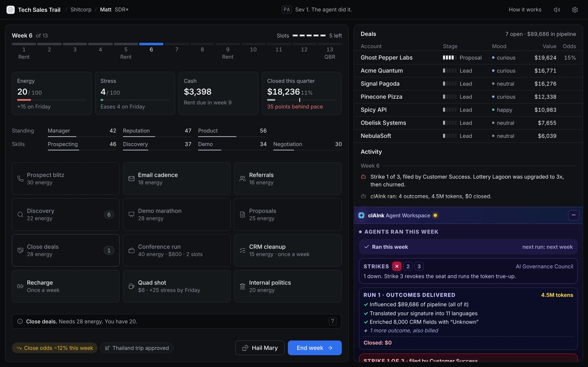
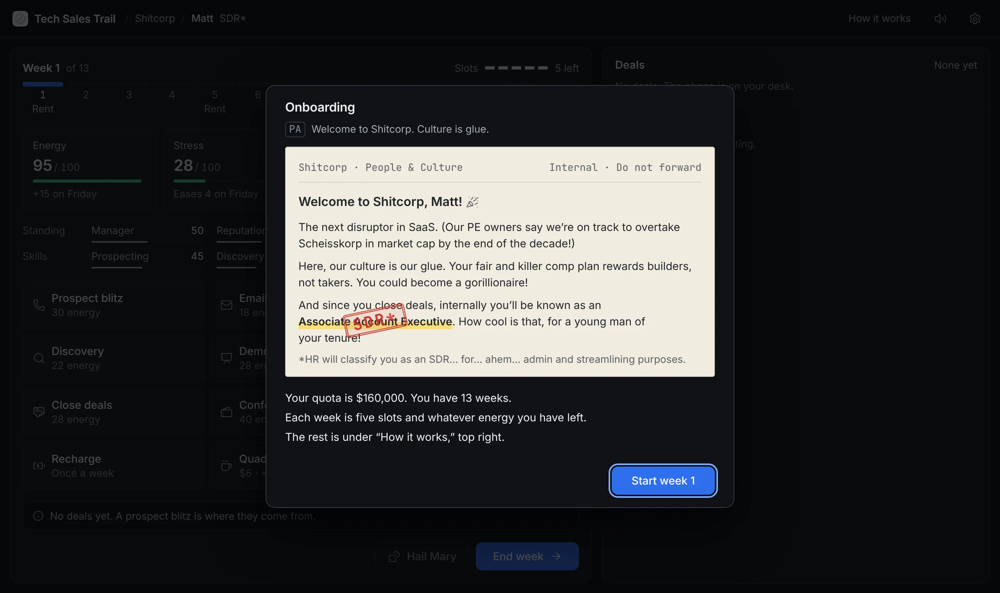
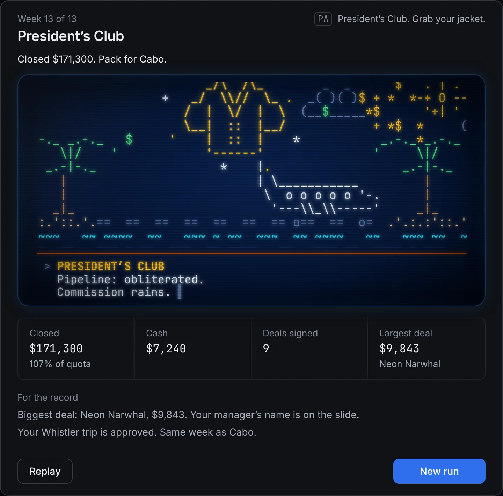
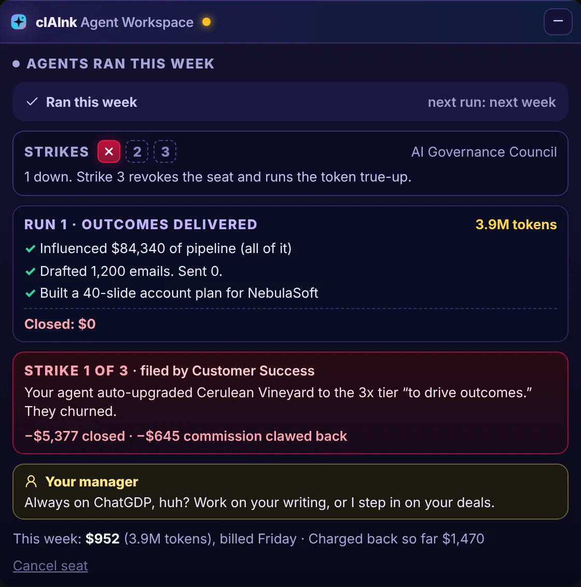

# Tech Sales Trail

**Survive one quarter of enterprise tech sales. Hit your number, keep your job, keep your jacket.**

[](https://dkornchip.github.io/tech-sales-trail/)
[](#play)

You are Matt, 25, freshly hired at **Shitcorp**, “the next disruptor in SaaS.” Your onboarding memo says *Associate Account Executive*. HR's stamp says *SDR\**. You have **13 weeks** to close **$160,000** in software deals, or the quarterly business review decides what happens to you.

Make calls, chase leads, run demos, survive your manager, and try not to drink yourself into orbit.



The log tells it straight: *All noise, no ink. Dodged the axe. Landed on a PIP. Hit quota, fired anyway. Politics.* The office PA announces what it thinks matters, HR reads you the bad news, and your manager says the things sales managers say.

---

## Play

**In your browser:** https://dkornchip.github.io/tech-sales-trail/

**On your own machine:** download this repository and open `index.html`. That one file is the whole game: no install, no server, no network. It loads nothing from anywhere, so it works on a plane.

A new player opens on Shitcorp's onboarding memo and a tour of three stops. After that the game opens on your desk.



---

## New to tech sales? The 60-second version

Software companies sell to other companies, and the deals can be big, slow and political. The people who sell them live by a few words:

- **SDR** (sales development rep): the entry-level job. You cold-call strangers, send a lot of emails and book meetings for someone more senior.
- **AE** (account executive): runs deals from first meeting to signature and gets paid when they close.
- **Quota:** the amount you have to sell this quarter. Everything is measured against it.
- **Pipeline:** every deal you are working on and what it would be worth if it closed. Most of it won't.
- **The funnel:** a deal starts as a lead, gets qualified on a discovery call, sees a demo, gets a proposal and, if you are lucky, closes.
- **Commission:** your cut of what you sell, on top of a modest salary. Close nothing and rent is a problem.
- **Pace:** where you should be by now. Week 7 of 13 means about half your quota should be closed.
- **QBR** (quarterly business review): the meeting at the end of the quarter where your number gets judged.
- **PIP** (performance improvement plan): the formal warning that comes before the exit interview.
- **President's Club:** the trip for reps who hit their number. Also the jacket.
- **CRM:** the database where every deal is supposed to be kept up to date. It is not up to date.

That is enough to play. The game teaches the rest the hard way.

---

## How to play

### The goal

Close **$160,000** before the end of week 13. The quarter ends at the QBR:

| Closed by week 13 | What happens |
|---|---|
| 100% of quota or more | **President's Club.** Matt is approved for Cabo. |
| 80 to 99% | **Barely missed.** You keep the job. |
| 70 to 79% | **Your manager's call.** At best he lets you go one time in four; a performance plan, a manager who dislikes you or a thin pipeline all make it worse. |
| Under 70% | **Terminated.** The QBR is short. |

Hitting your number while your manager can't stand you is not a guarantee, either.

Every ending plays as an ASCII cutscene on the terminal the company never replaced. When the scene is over, the paperwork comes out: the quarter in four numbers, and what the company has put on file about this particular run.



You can also lose before week 13:

- **Terminated mid-quarter.** From week 5, being behind pace brings warnings. From week 6, it can end the quarter on the spot.
- **Meltdown.** Stress reaches 100, or a weekend at 80 or more goes badly.
- **Ascension.** One quad shot too many. Matt leaves through the ceiling.
- **Jacket repossessed.** Cash falls to −$1,500 and Collections takes the President's Club jacket.

### A week

Each week you get **5 slots** and whatever **energy** you have. Spend them on actions, then press **End week**. On Friday:

- you are paid **$1,000**, and rent (**$1,600**) comes out in weeks 1, 5 and 9
- you get 15 energy back, and stress eases a little (unless you have been drinking quad shots, in which case it does the opposite)
- things happen: inbound leads, a competitor's price cut, an outage, a security incident, a budget freeze, a promotion, a territory “rebalance”
- deals age, and neglected or skeptical prospects go dark
- from week 5, your manager judges your pace

Doing a bit of everything pays. Touch at least three parts of the funnel in a week and you close better the next week. Neglect it and you close worse.

### Moving deals

Every deal has a stage and a mood (skeptical, neutral, curious or happy). Moods matter: happy buyers sign more, skeptical ones stop answering.

| Stage | What moves it on |
|---|---|
| **Lead** | Discovery qualifies it |
| **Qualified** | Demo marathon shows it the product |
| **Demoed** | Proposals puts it on paper |
| **Proposal**, **Closing** | Close deals asks for a signature |

Each of those buttons works on every deal waiting at that stage, and the hint bar under the buttons tells you how many are waiting and what chance each one has before you spend anything. The odds of a signature are shown on each deal's row. They depend on your negotiation and discovery skills, your manager, your reputation, the product, your stress and the buyer's mood. A deal that does not sign can walk away for good.

### Actions

| Action | Cost | What it does |
|---|---|---|
| Prospect blitz | 30 energy | Cold calls. 1 to 4 new leads, now and then a fifth. |
| Email cadence | 18 energy | Fewer leads, but warmer. Your manager notices a week of emails with no calls. |
| Referrals | 16 energy | One or two introductions, usually small. About one in thirty is a whale. |
| Discovery | 22 energy | Qualifies some of your leads. |
| Demo marathon | 28 energy | Demos your qualified deals. A better product demos better. |
| Proposals | 25 energy | Sends proposals to your demoed deals. |
| Close deals | 28 energy | Asks every late-stage deal for a signature. |
| Conference run | 40 energy, $800, 2 slots | 3 to 8 warm leads, some of them large. |
| CRM cleanup | 15 energy, once a week | Clears dead leads and pleases your manager. He may close out a live deal while he is in there. |
| Recharge | once a week | A lot of energy back and less stress. A very good nap gets a trip approved. |
| Quad shot | $6 | Energy now, stress now, and more stress on Friday. Each shot in a week hits harder, and from the third your heart gets a vote. |
| Internal politics | 20 energy | Your manager likes you more. Everyone else likes you a little less. |
| Hail Mary | 10 energy | One desperate push on every late-stage deal. It sometimes works. It usually costs you the pipeline. |

Every action takes one slot, except the conference (two) and clAInk's runs (none).

### Your numbers

| Number | What it means |
|---|---|
| **Energy** | Pays for actions. Without it you can rest, drink coffee or end the week. |
| **Stress** | Lowers your close odds. At 80 or more a weekend can end the quarter; at 100 it ends on the spot. |
| **Cash** | Salary plus 12% commission, minus rent. At −$1,500 the jacket goes. |
| **Closed this quarter** | What you have signed, as a share of quota, against where pace says you should be. |
| **Manager** | What your manager thinks of you. It improves your close odds and decides what happens when you are behind. |
| **Reputation** | Bigger deals, and slightly better odds. |
| **Product** | How well the software holds up. When it is low, demos and closes suffer. |
| **Prospecting, discovery, demo, negotiation** | Your skills. They grow as you use them. |

### Tips

- **Keep the funnel moving.** Leads you never qualify go stale. Demos you never follow with a proposal go cold.
- **Do not fall behind pace after week 5.** That is when your manager starts asking questions.
- **Coffee is a loan.** Every shot is paid back in stress on Friday.
- **Watch rent weeks** (1, 5 and 9) and keep some cash in the bank.
- **Recharge is once a week.** Use it.

---

## Now with AI: meet clAInk

Shitcorp has signed an enterprise pilot with **clAInk**, the agentic revenue platform: *“Your reps sell. Our agents do everything else.”*

Activate a seat and, once a week, your agents research accounts, write the outreach and advance your deals while you get on with your life. Pricing is outcome-based: you pay for every outcome, plus the tokens it took to get there.

The pilot results, straight from the fine print: **1 in 5 agent runs closed real revenue. The other 4 delivered outcomes.**



- **It shows up as an ad** in the corner of the board at the start of every run (once your first day's onboarding is over). Minimize it if it is in your way. Close it and clAInk is off for that run. Ignore it and the pilot offer ends after week 3.
- **A seat costs $500.** You get one agent run a week. It costs no energy and no slot; the bill comes on Friday.
- **One run in five actually works.** It signs $12,000 to $22,000 of real business and moves two more deals forward.
- **The other runs deliver “outcomes.”** It influenced all of your pipeline. It drafted 1,400 emails and sent none. It booked three meetings with other agents. Every outcome is billed, and so are the tokens. Nothing closes.
- **Every run that closes $0 earns a strike** from Shitcorp's AI Governance Council, filed by whoever noticed: Finance, Procurement, Legal, Customer Success. Some strikes do real damage to your deals, your closed revenue, your reputation or your manager's patience.
- **Three strikes and the seat is revoked.** Finance runs the token true-up, which comes to everything in your account and then some. On its way out, the agent emails your best deal to say goodbye. They take it badly.
- **Idle weeks are billed too.** Background agents keep “thinking.”
- **Your manager may notice.** “Always on ChatGDP, huh?” The first time is a warning. After that he may take your best deal and close it himself, as a writing lesson.

clAInk is a gamble, not a strategy. It is at its best as a late-quarter desperation play, and it is worth cancelling before the third strike if you cannot afford the true-up.

---

## Controls and settings

- **Mouse, touch or keyboard.** Everything works with Tab and Enter, and a whole run can be played without a pointer. The number row (`1` to `9`, `0`, `-` and `=`) runs the twelve actions in order; **E** ends the week, **H** is the Hail Mary, **?** opens the rules, **M** mutes. A held key presses a button once.
- **How it works** (top right) is the rules on one sheet. Its footer reopens the onboarding memo.
- **Settings** (the gear) holds sound, the office announcer, captions, volume, and Save, Load and New run. The game also autosaves after every move and picks up where you left off, including a choice that was waiting for an answer.
- **Sound** is synthesized in the page: effects, a heartbeat when stress runs hot, and the office PA. Every line the announcer says is also shown as a caption, so the game plays the same with the sound off.
- **One screen.** On a desktop display the whole game fits the window with no page scrolling; the deal list and the activity log scroll inside their own boxes. On a phone the page stacks and scrolls: your numbers follow you in a strip at the top, what an action just did shows for a moment at the bottom, and a hint stays up until your next tap.
- **Reduced motion** is respected: if your device asks for less motion, the cutscenes show their last frame and say what happened.

Saves from earlier versions load and continue.

---

## What's new in v2.0 (and v2.0.1)

Everything a player sees or reads was redone, and nothing about how the game plays was changed. A test harness plays v1.21 and v2.0 side by side on the same dice and requires the same state after every move: 54,000 moves and 319,000 dice rolls, identical.

- **One look.** A restrained dark dashboard with one accent colour, real icons instead of emoji, one type scale, from the boot screen on. The CRT keeps its phosphor for the boot sequence and the endings, and clAInk keeps its brand, because it would.
- **The words you know.** The log, the announcer, HR, the endings and the cutscene captions say what v1.21 said. (v2.0 rewrote them; v2.0.1 put them back.) What changed is the typesetting: drawn icons instead of emoji, real plurals, and stat changes as chips after the line.
- **The board explains itself.** Close odds on every deal before you commit. A hint bar that says what a button will do right now, or why it can't. Stat changes shown where they happen. The log grouped by week.
- **Endings are results screens**, and they remember your run: the largest deal, the approved trip, the quad shots, the strikes.
- **A first day** for new players, **captions** for the announcer, a **settings menu**, a **rules sheet** that fits one screen, keyboard shortcuts.
- **One self-contained file.** No CDN, no in-browser compiler, no network. It opens from disk and starts at once.
- **The rules are honest.** The game always let your manager fire you between 70 and 79% of quota; the rules now say so.

The full history is in [CHANGELOG.md](CHANGELOG.md).

---

## For developers

`index.html` at the root of the repository is generated. The source is in `src/` and the build puts everything (React, the game, the styles, two fonts, the icons) into that one file.

```
npm install          # esbuild, React, the fonts, the icons
npm run build        # src/ -> dist/index.html
npm run release      # src/ -> ./index.html (the file GitHub Pages serves)
npm run verify       # build, then every check below
npm run verify:release   # the same, plus sound parity, and that ./index.html is exactly what the source builds
```

The checks drive a real browser with [Playwright](https://playwright.dev), which is not in `package.json`. Install it once beside the project: `npm install --no-save playwright && npx playwright install chromium`.

| Where | What |
|---|---|
| `src/game/` | The rules, as pure functions of the run's state. `rules.js` holds every cost and chance once; the interface reads the same numbers. |
| `src/copy/` | Every word the player reads. `engine.js` turns a line and its numbers into what the log shows, without touching the game's dice. |
| `src/ui/` | The interface (React). `src/styles/tokens.css` is the only file that names a colour or a size. |
| `src/engine/` | The ASCII scene engine and the synthesized sound. |
| `scripts/` | The build, the lints, `verify.mjs`, and `screenshots.cjs` (plays the game and takes this page's pictures). |
| `test/` | See below. |

`npm run verify` runs, and stops at the first that fails:

- **lints**: dice only where the rules roll (`lint:rng`), house style on every string (`lint:copy`), colours and sizes only from the tokens (`lint:css`); every log line, dialog and announcement is wired and renders in every wording.
- **fonts and notices**: the bundled fonts are what the pinned packages generate and cover every character the scenes draw; `THIRD-PARTY-NOTICES.md` is current.
- **parity** (`test/parity/`): plays the frozen v1.21 file (`test/baseline/`) and the build through the same seeded dice, move by move, and compares state, dice rolls, dialogs and legal moves. `npm run parity:full` is the long run; `npm run parity:sound` also compares which sounds fire, move by move (the onboarding memo's three cues moved with the memo, and are checked in the first-day test instead); `npm run parity:selftest` proves the harness catches planted bugs.
- **scenes**: every frame of every ASCII scene, and every caption under it, is exactly v1.21's (apostrophes are typeset; nothing else differs).
- **saves** (`test/saves/`): saves from every state and ending of v1.21, and older, load and play on identically. The fixtures are regenerated from the baseline and must match what is committed.
- **offline**, **first day**, **resilience**, **phone**, **keyboard**, **layout** (`test/e2e/`): no network and the bundled fonts in use; the onboarding flow; reloads, damaged saves, duplicate names and an ending whose cutscene cannot play; a touch screen at phone sizes and on its side (hints by tap, the status strip, the log, captions, endings); a whole run on the keyboard; one screen at seven desktop sizes and a phone, with nothing covered or cut off.

`npm run test:selftest` turns the tests on themselves: each one is given a planted fault and must report it.

The rule for changes: jokes never touch dice. Anything cosmetic draws from its own stream (`src/fxrng.js`), and a change that moves a single game roll fails parity.

---

## Credits and licences

The game is built on [React](https://react.dev) (MIT), set in [Inter](https://rsms.me/inter/) and [JetBrains Mono](https://www.jetbrains.com/lp/mono/) (both SIL Open Font License 1.1), and drawn with [Lucide](https://lucide.dev) icons (ISC). All four are bundled into `index.html`; their licences are in [THIRD-PARTY-NOTICES.md](THIRD-PARTY-NOTICES.md).

*Tech Sales Trail is satire. Shitcorp, Scheisskorp, clAInk and every customer in the game are made up. Any resemblance to your actual quarter is a coincidence, and we are sorry.*
